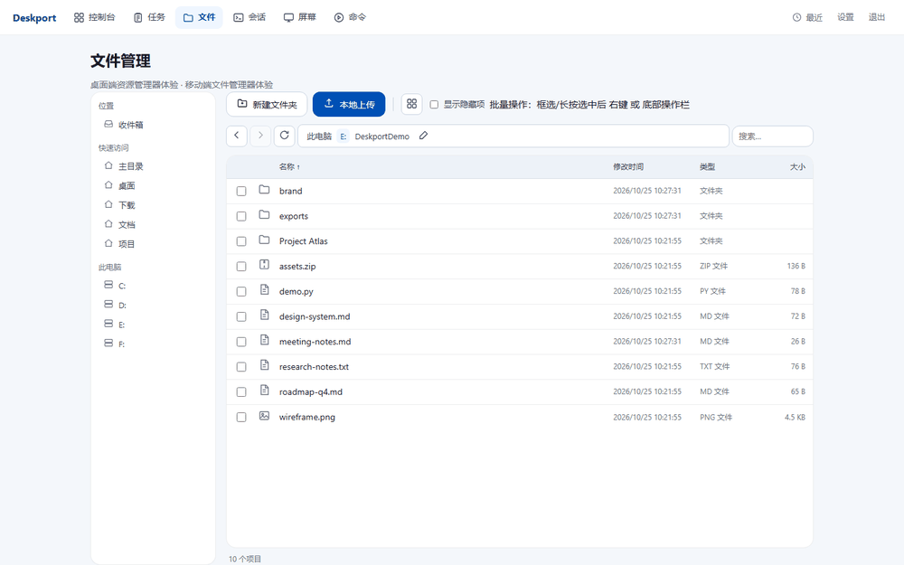
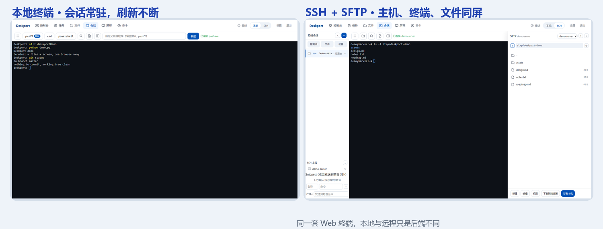
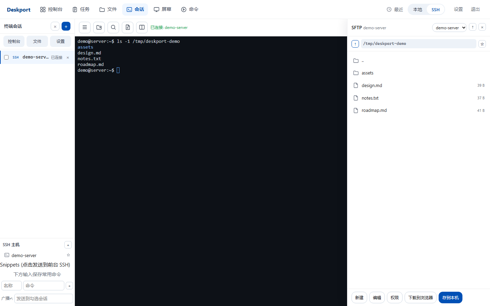
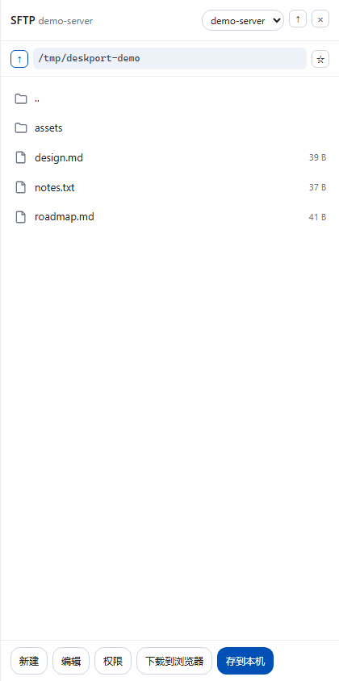
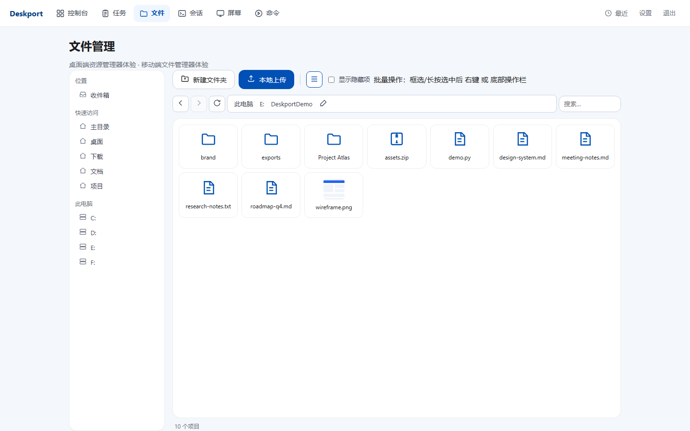
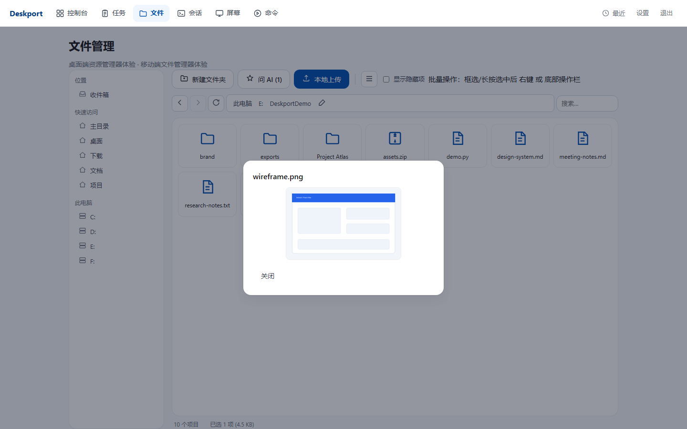
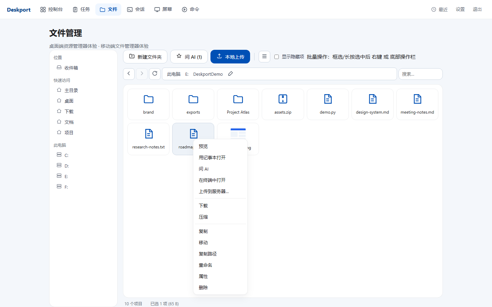
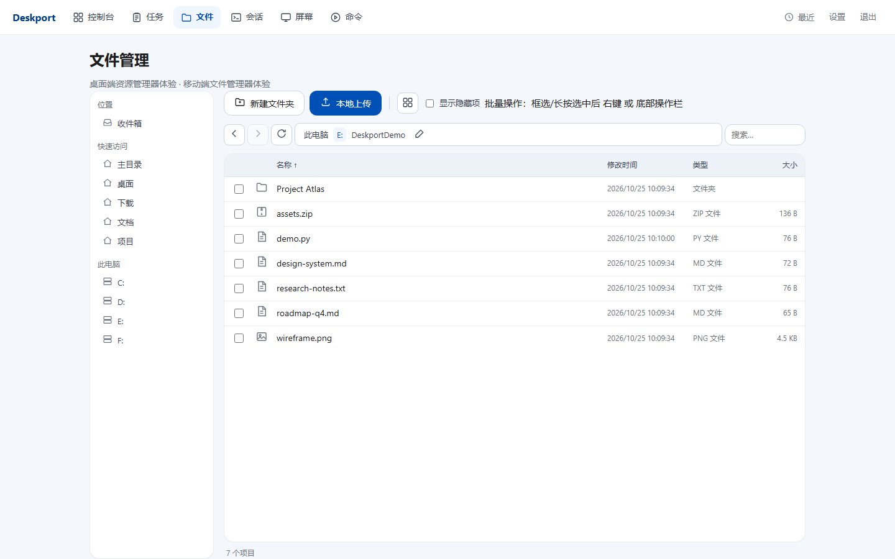
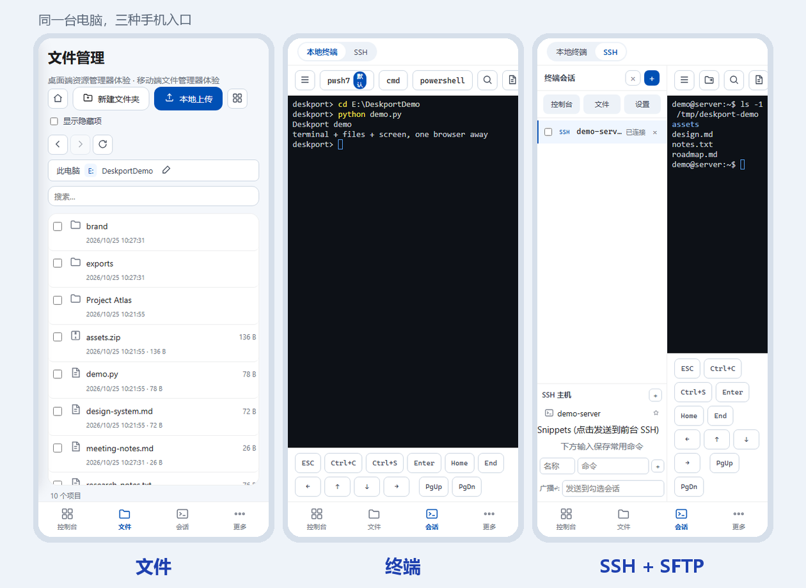

# Deskport

> **自己的电脑，一个浏览器就能到。**

Deskport 是一个自托管的个人电脑控制台。手机、平板或另一台电脑打开一个网址，就能拿到你真实机器的终端、文件、屏幕和常用控制——不用装客户端，不经过厂商云。

它面向 Vibe Coder 和重度个人电脑用户：不只写代码，也能处理文件、跑 AI、看屏幕、做日常操作。



## 5 分钟看懂

| 你想要的 | Deskport 给你的 |
|---|---|
| 在手机上继续电脑里的终端和 AI 会话 | 会话常驻在电脑上，手机浏览器随时 attach |
| 远程连服务器 | 内置 SSH + SFTP，不是“再开一个工具” |
| 在手机上翻文件、看图片、改两行字 | 完整文件管理：缩略图、预览、编辑、压缩、搜索 |
| 看电脑真实屏幕、点两下 | MJPEG 单捕获广播 + 鼠标/键盘控制 |
| 不装客户端 | 手机/平板/另一台电脑只用浏览器 |
| 不把代码搬进云端 IDE | 真正的机器、真正的 shell、真正的文件 |

## 终端：本地和 SSH，是同一套体验

传统远程桌面传的是**整块屏幕**；Deskport 的终端传的是**字符**。  
所以延迟低、流量小，而且会话活在电脑上，不在浏览器页面里。



| | 本地终端 | SSH |
|---|---|---|
| 后端 | Windows ConPTY | paramiko |
| 认证 | 无 | 密码 / 密钥 / keyboard-interactive (2FA) |
| 文件 | 文件管理页 | 右侧 SFTP 面板，同屏操作 |
| 会话 | 常驻、回放、抢占接管 | 同一套会话模型 |
| 适合 | 本机脚本、AI CLI、PowerShell | 服务器开发、运维、传文件 |

两边共用同一个 Web 终端前端：快捷键、搜索、回放、虚拟按键、断线重连都一样。  
**刷新页面不会杀会话；web 重启也不会。**

## SSH 不是只有终端：SFTP 是完整文件工作台



- 左侧主机列表、中间终端、右侧 SFTP，一个界面完成“连上、看文件、改文件、传文件”
- 目录浏览、上传、下载到浏览器、存到本机、重命名、删除、新建、chmod
- 文本文件直接打开编辑；保存时带 mtime 冲突检查
- 常用目录可以固定到快速访问；路径记忆按主机隔离
- 文件管理页里的任意文件/文件夹，也可以直接“上传到服务器”



## 文件管理：像资源管理器，但在浏览器里

<table>
<tr>
<td></td>
<td></td>
</tr>
<tr>
<td align="center">图标视图 + 图片缩略图</td>
<td align="center">双击预览图片 / 文本</td>
</tr>
<tr>
<td></td>
<td></td>
</tr>
<tr>
<td align="center">右键：预览、问 AI、在终端打开、上传到服务器</td>
<td align="center">详细视图：类型、大小、时间、批量操作</td>
</tr>
</table>

- 双击默认预览，右键才是下载/重命名/删除/压缩
- 图片直接显示缩略图；文本预览保留原编码，GBK 文件不会保存成 UTF-8 乱码
- 多选、框选、长按菜单、批量压缩/解压/下载
- 文件夹可下载为 ZIP；大文件走流式压缩，不占内存
- 快速访问可固定任意目录；搜索支持递归文件名

## 手机端：不是把网页缩小



- PWA 安装到桌面，打开就是独立 App 的感觉
- 专用虚拟按键：Ctrl、Ctrl+C、Ctrl+S、Enter、方向键、PgUp/PgDn
- 底部导航、全屏 SFTP、长按菜单、底部动作条
- 终端会话、文件目录、滚动位置都会记住；切回来还在原地

## 为什么它对 Vibe Coder 更顺手

**传几个字母，不需要传整个画面。**  
RDP/远程桌面为“看屏幕”优化；写代码、跑命令、和 AI 对话，本质是字符流。Deskport 的终端不是屏幕视频，是原生 PTY。

**会话属于电脑，不属于页面。**  
电脑上打开的终端，手机可以随时 attach；手机切走、刷新、甚至 web 重启，会话都还在。你不需要“在手机上重新开一个环境”。

**同一台电脑，不是云端 IDE。**  
你的文件、GPU、模型、微信、Office、AI CLI 都在这台机器上。Deskport 只是把入口变成浏览器。

**一个入口，而不是五个工具。**  
终端、SSH、SFTP、文件、屏幕、进程、电源、AI 任务都在同一个壳里。

## 还能做什么

- **控制台**：进程/窗口管理、启动应用、关机/重启/锁屏/睡眠、音量键、向窗口发送文本
- **AI 交接**：把文件/文件夹交给终端里的 AI CLI，任务常驻、可继续、权限请求可见
- **收件箱**：默认关闭；开启后按你配置的目录聚合微信/QQ/下载/桌面的新文件
- **PWA**：手机安装后像独立 App；记住上次视图和会话
- **品牌名**：设置页可改顶栏、登录页与 PWA 名称（默认 Deskport）
- **插件**：原生清单 + RemoteConnecter legacy 插件直接导入（见 [docs/plugin-api.md](docs/plugin-api.md)）

## 30 秒开始

环境：Windows 10/11 + [uv](https://docs.astral.sh/uv/)。

```powershell
uv sync
copy config.example.json config.json
# 编辑 config.json，至少设置 password
.venv\Scripts\python.exe app.py
```

打开 `http://127.0.0.1:6789`。手机和电脑在同一网络时，用 `http://<电脑IP>:6789` 访问。

最小配置：

```json
{
  "port": 6789,
  "password": "换成一个强密码"
}
```

更多字段见 [docs/deployment.md](docs/deployment.md)。

## 配合内网穿透食用

Deskport 只监听本机端口，家里/公司网络通常没有公网 IP。**不要直接把 6789 裸奔到公网**；优先用私有网络（Tailscale / ZeroTier），需要域名再用 Cloudflare Tunnel、frp + Caddy 等，并确保全程 HTTPS。

常见方案、最小配置和 WebSocket/MJPEG 注意事项见 [docs/remote-access.md](docs/remote-access.md)。

## 它是怎么工作的

```
浏览器（手机 / 平板 / 另一台电脑）
   │  HTTP + WebSocket
   ▼
web（认证、UI、文件、控制台）
   ├── WS 代理 ──> locald（本机 ConPTY 终端）
   └── WS 代理 ──> sshd  （paramiko SSH）
```

- web 重启不会杀掉终端/SSH 会话
- 会话状态在守护进程里，页面只是附着
- 单用户、单机部署，配置和状态都在你自己的电脑上

## 安全模型

Deskport 暴露的是完整的本机控制能力，请把它当作“远程管理入口”对待：

- 单用户、单密码；密码明文保存在本机 `config.json`
- 默认 HTTP，无内置 TLS/TOTP/CSRF
- **不要直接把端口暴露到公网**；远程访问请放在 HTTPS 反向代理、VPN 或可信内网之后
- 使用强密码；不需要时关闭服务
- 收件箱扫描默认关闭，只扫描你显式配置的目录

## 这不是什么

- 不是云电脑：你的电脑必须开着、联网
- 不是多租户/团队协作平台
- 不是高帧率游戏串流
- 目前只支持 Windows

## Roadmap

- 办公文档预览与批注流
- 手机 ↔ 电脑剪贴板
- 文件限时分享链接
- 更完整的移动端手势与键盘
- 多显示器与屏幕选择

## 开发与测试

```powershell
.venv\Scripts\python.exe -m pytest tests -q
.venv\Scripts\python.exe tools/check_structure.py
```

终端/SSH 端到端验证需要启动 `app.py` 与两个 `sessiond.py`，见 [docs/ops.md](docs/ops.md)。

## 文档

见 [docs/README.md](docs/README.md)。

## 许可证与来源

本项目以 [MIT](LICENSE) 发布。第三方依赖见 [THIRD_PARTY_NOTICES.md](THIRD_PARTY_NOTICES.md)。

Deskport 最初受到开源项目 [mc-lhz/RemoteConnecter](https://github.com/mc-lhz/RemoteConnecter) 的启发，并在其基础上大量借鉴、重构和扩展。原项目版权归其作者所有；上游仓库未附许可证，上游作者已说明其仓库可无限制使用，具体授权请以你获取到的上游说明为准。
