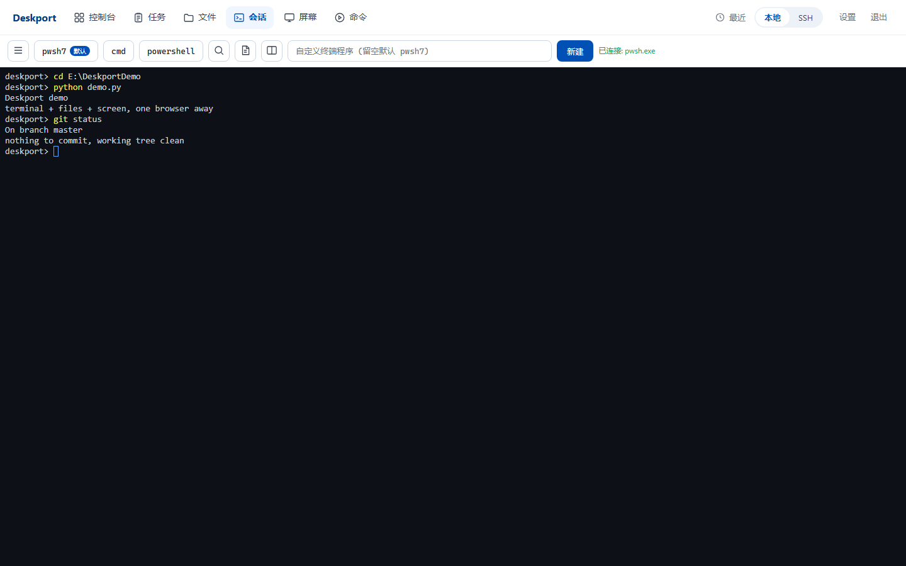
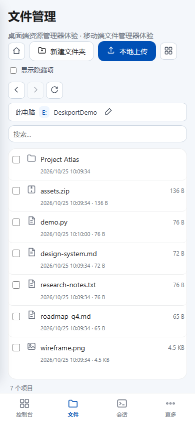

# Deskport

> **自己的电脑，一个浏览器就能到。**

Deskport 是一个自托管的个人电脑控制台。手机、平板或另一台电脑打开一个网址，就能拿到你真实机器的终端、文件、屏幕和常用控制——不用装客户端，不经过厂商云。

它面向 Vibe Coder 和重度个人电脑用户：不只写代码，也能处理文件、跑 AI、看屏幕、做日常操作。


## 为什么做这个

传统远程桌面为“看屏幕”设计：把整块画面编码、传输、再解码。延迟低的时候能用，但用来写代码、跑终端、和 AI 对话，体验并不好——传几个字符的事情，没必要传整个画面。

Deskport 换了一个思路：

- **终端只传字符**：本地终端、SSH 都是原生 PTY 流，不是屏幕视频
- **会话活在 web 服务里**：电脑上打开、手机上 attach，刷新页面也不断
- **浏览器就是客户端**：不需要在手机/平板装任何 App
- **移动端按手机设计**：PWA、虚拟按键、手势、响应式布局，尽量接近原生
- **整机而不只是 coding**：文件、屏幕、键鼠、进程、电源、AI 任务都在同一个地方

## 你能得到什么

- **终端**：本机 PowerShell 7 / cmd，多会话、断线重连、回放、抢占接管
- **SSH**：密码/密钥/2FA、known_hosts TOFU、SFTP 浏览与传输
- **文件管理**：浏览、缩略图、文本预览（保留原编码）、压缩/解压、搜索、打包下载
- **收件箱**：默认关闭；开启后按你配置的目录聚合微信/QQ/下载/桌面的新文件
- **实时屏幕**：MJPEG 单捕获广播，多客户端不降帧；支持鼠标/键盘控制
- **控制台**：进程、窗口、应用启动、关机/重启/锁屏/睡眠、音量键、向窗口发送文本
- **AI 交接**：把文件/文件夹交给终端里的 AI CLI，任务常驻、可继续、权限可见
- **PWA**：手机安装后像独立 App；记住上次视图和会话

## 30 秒开始

环境：Windows 10/11 + [uv](https://docs.astral.sh/uv/)。

```powershell
uv sync
copy config.example.json config.json
# 编辑 config.json，至少设置 password
.venv\Scripts\python.exe app.py
```

然后打开 `http://127.0.0.1:6789`。手机和电脑在同一网络时，用 `http://<电脑IP>:6789` 访问。

最小配置：

```json
{
  "port": 6789,
  "password": "换成一个强密码"
}
```

更多字段见 [docs/deployment.md](docs/deployment.md)。

## 截图

桌面端文件管理：


桌面端终端：



移动端：



## 它是怎么工作的

```
浏览器（手机 / 平板 / 另一台电脑）
   │  HTTP + WebSocket
   ▼
web（认证、UI、文件、控制台）
   ├── WS 代理 ──> locald（本机 ConPTY 终端）
   └── WS 代理 ──> sshd  （paramiko SSH）
```

- web 重启不会杀掉终端/SSH 会话
- 会话状态在守护进程里，页面只是附着
- 单用户、单机部署，配置和状态都在你自己的电脑上

## 安全模型

Deskport 暴露的是完整的本机控制能力，请把它当作“远程管理入口”对待：

- 单用户、单密码；密码明文保存在本机 `config.json`
- 默认 HTTP，无内置 TLS/TOTP/CSRF
- **不要直接把端口暴露到公网**；远程访问请放在 HTTPS 反向代理、VPN 或可信内网之后
- 使用强密码；不需要时关闭服务
- 收件箱扫描默认关闭，只扫描你显式配置的目录

## 这不是什么

- 不是云电脑：你的电脑必须开着、联网
- 不是多租户/团队协作平台
- 不是高帧率游戏串流
- 目前只支持 Windows

## Roadmap

- 办公文档预览与批注流
- 手机 ↔ 电脑剪贴板
- 文件限时分享链接
- 更完整的移动端手势与键盘
- 多显示器与屏幕选择

## 开发与测试

```powershell
.venv\Scripts\python.exe -m pytest tests -q
.venv\Scripts\python.exe tools/check_structure.py
```

终端/SSH 端到端验证需要启动 `app.py` 与两个 `sessiond.py`，见 [docs/ops.md](docs/ops.md)。

## 文档

见 [docs/README.md](docs/README.md)。

## 许可证与来源

本项目以 [MIT](LICENSE) 发布。第三方依赖见 [THIRD_PARTY_NOTICES.md](THIRD_PARTY_NOTICES.md)。

Deskport 最初受到开源项目 [mc-lhz/RemoteConnecter](https://github.com/mc-lhz/RemoteConnecter) 的启发，并在其基础上大量借鉴、重构和扩展。原项目版权归其作者所有；上游仓库未附许可证，上游作者已说明其仓库可无限制使用，具体授权请以你获取到的上游说明为准。
